# `▁▂▃▅▇█▆▃ tripsit.dev`

**Your agent writes the code. We show you where it guessed.**

tripsit.dev turns GitHub issues into pull requests with a coding agent (Gemma 4 31B, served on Modal), then hands the
change to a human reviewer as an interactive dependency graph. Every edited function, class and file carries a
**confidence score computed from the model's own token probabilities**, and the agent flags the assumptions and
judgement calls it made. Review starts where the agent was unsure, and nothing is merged until a person clicks
**Approve & merge**.

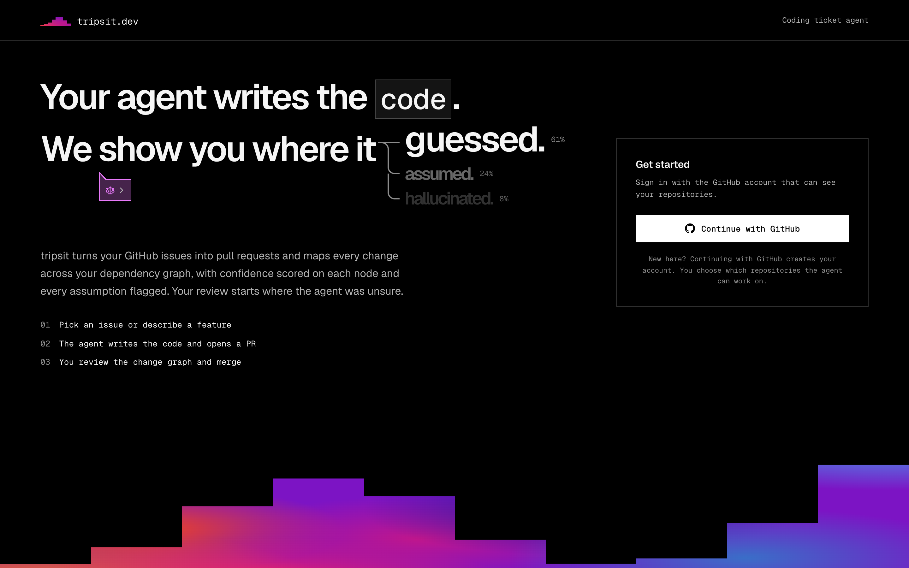

**Contents**

- [What it does](#what-it-does)
- [Tech stack](#tech-stack)
- [How it works](#how-it-works)
- [Using tripsit.dev](#using-tripsitdev)
- [Gemma 4 on Modal](#gemma-4-on-modal)
- [Getting token probabilities out of Gemma](#getting-token-probabilities-out-of-gemma)
- [Edit confidence: scoring every file and function](#edit-confidence-scoring-every-file-and-function)
- [Setup](#setup)
- [Deployment](#deployment)
- [Development](#development)
- [Security notes](#security-notes)
- [Earlier development slices](#earlier-development-slices)

---

## What it does

| | |
| --- | --- |
| **Implements tickets** | Pick an open GitHub issue or describe a feature. A pi coding agent running Gemma 4 works in a fresh copy of the repository's default branch, then opens a pull request from a `tripsit/…` branch. |
| **Maps the change** | A dependency graph shows the changed files and functions and the code that uses them, with new and removed dependencies marked. |
| **Shows where it guessed** | Each changed function, class and file gets a white-box confidence score: the [uqlm](https://github.com/cvs-health/uqlm) `min_token_negentropy` of the tokens that wrote it. Low-confidence edits get a comment with the token the model hesitated on and the alternatives it weighed. |
| **Flags its own assumptions** | The agent marks assumptions, judgement calls and high-impact edits for the reviewer. |
| **Keeps a human in charge** | The reviewer approves and merges, or rejects and closes, the pull request from the run view. GitHub records both as that person. |

## Tech stack

| Layer | Technology |
| --- | --- |
| Web app | [SvelteKit](https://svelte.dev/docs/kit) 3 with Svelte 5 runes, strict TypeScript, Node 22 (`adapter-node`) |
| Graph UI | [Svelte Flow](https://svelteflow.dev) cards laid out with [ELK.js](https://eclipse.dev/elk/) (layered), Lucide icons, Geist and Geist Mono |
| Sign-in | [Better Auth](https://www.better-auth.com) with GitHub, using a GitHub App's user tokens |
| Database | PostgreSQL on [Aiven](https://aiven.io) (`pg`) |
| Coding agent | [pi](https://github.com/badlogic/pi-mono) (`@mariozechner/pi-coding-agent`) with read, bash, edit, write and a custom `flag` tool |
| Model | [Gemma 4 31B-it](https://huggingface.co/google/gemma-4-31B-it) served by [vLLM](https://docs.vllm.ai) (Google's Gemma 4 build) |
| Inference hosting | [Modal](https://modal.com): one RTX PRO 6000 GPU, a FastAPI relay, a Modal Dict for token records |
| Confidence | uqlm's white-box `min_token_negentropy`, reimplemented in Python and checked against uqlm 0.6.8 |
| Hosting and CI | Aiven Runtime (Docker) for the web app; GitHub Actions for checks and the Modal deploy |

## How it works

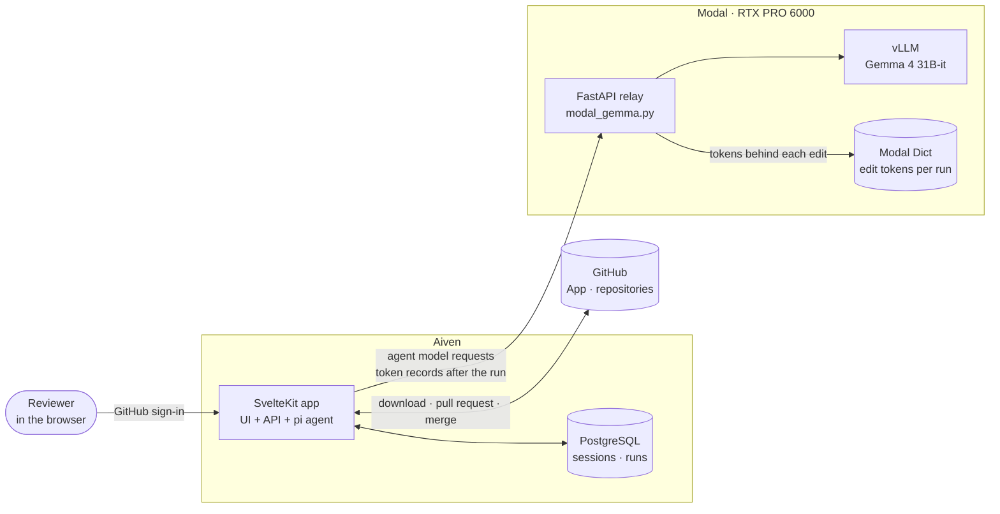

The web app runs the agent itself, in a temporary checkout on the server. Only model calls go to Modal. One run looks
like this:

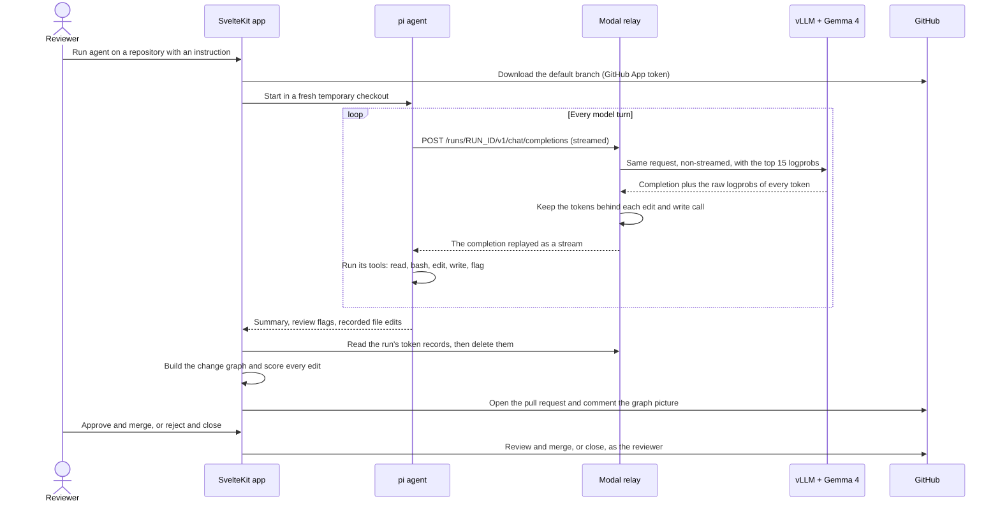

## Using tripsit.dev

### 1. Sign in with GitHub

Open the app and choose **Continue with GitHub**. Sign-in is GitHub only. The first sign-in creates your account.

### 2. Install the Tripsit agent

New users go through a short setup. Install the Tripsit GitHub App on your account or an organization and choose the
repositories it may work on. You can add more later from **+ Add repos** in the header.

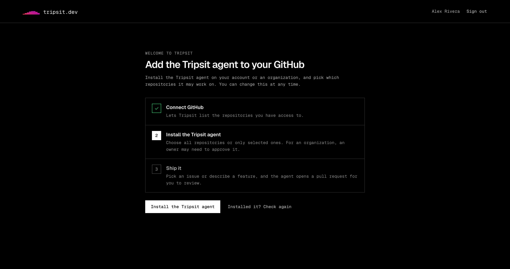

### 3. Pick a repository and describe the work

Choose the repository in the header. Its open issues are listed: click one to copy it into the instruction, or write
your own. Then press **Run agent**. Your earlier runs are on the right; they are kept for seven days.

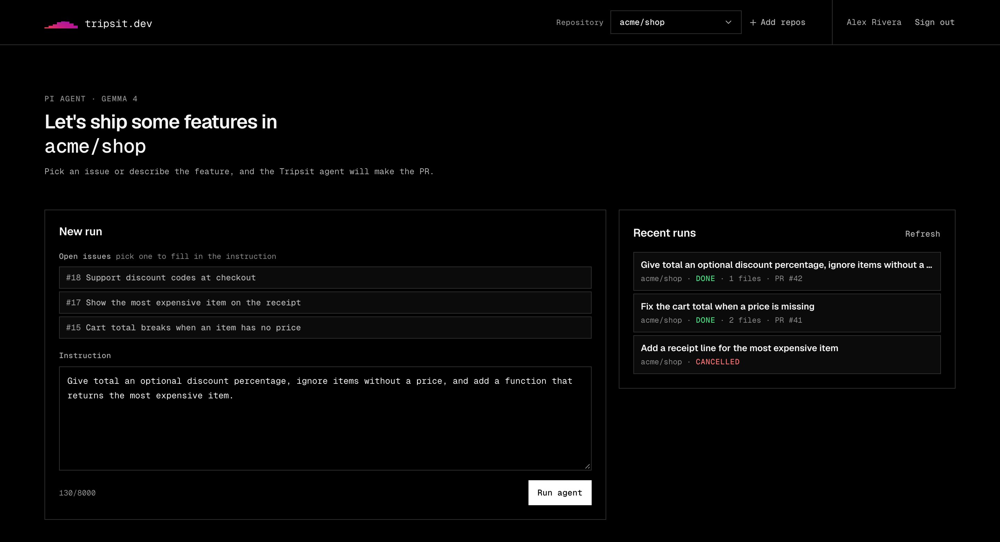

### 4. Watch the run and read the change graph

The agent reads the code, edits it and finishes with a summary and a pass in which it flags what you should look at.
The app then builds the change graph and scores the edits. If you can push to the repository, a pull request is
opened.

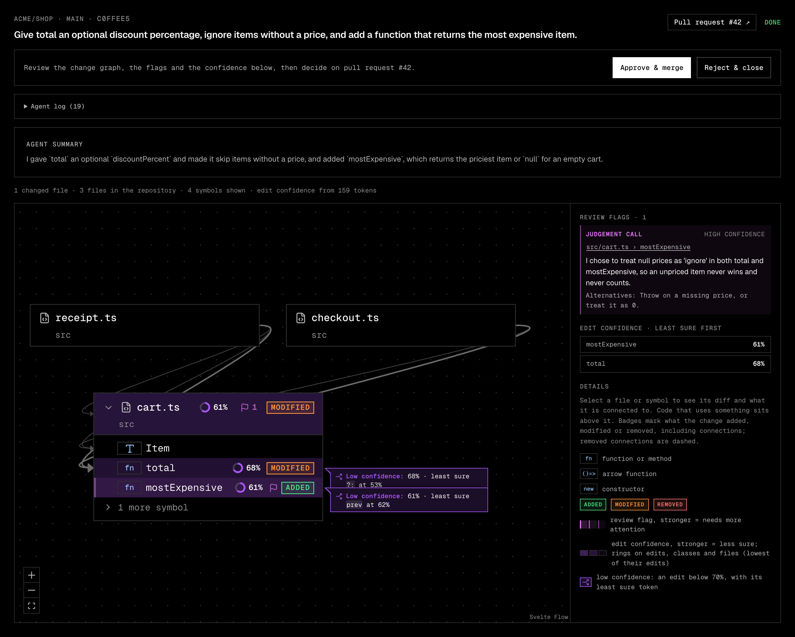

How to read the graph:

| What you see | What it means |
| --- | --- |
| Cards and rows | Files, with their functions, classes and methods. Code that uses something sits above it. |
| `ADDED` / `MODIFIED` / `REMOVED` badges | What the change did to the file, symbol or dependency. Removed dependencies are dashed. |
| Pink bubbles | Review flags from the agent: assumption, judgement call or high-impact edit. |
| Violet tint | Edit confidence. The less sure the model was, the stronger the tint. Confident edits stay almost transparent. |
| Progress ring with a percentage | The confidence of each scored function, class and file. Files and classes show the lowest score of the edits inside them. |
| Violet **Low confidence** bubble with a branching icon | An edit below 70%, with the token the model was least sure of. One bubble per weak spot, on the most specific row. |

Click a **Low confidence** bubble, or its ring, to open the details: the score, Min. token negentropy, the least sure
token and what the model would otherwise have written. Here the model hesitated between an optional parameter
(`?:`, 53%) and a default value (` =`, 41%), a real API decision.

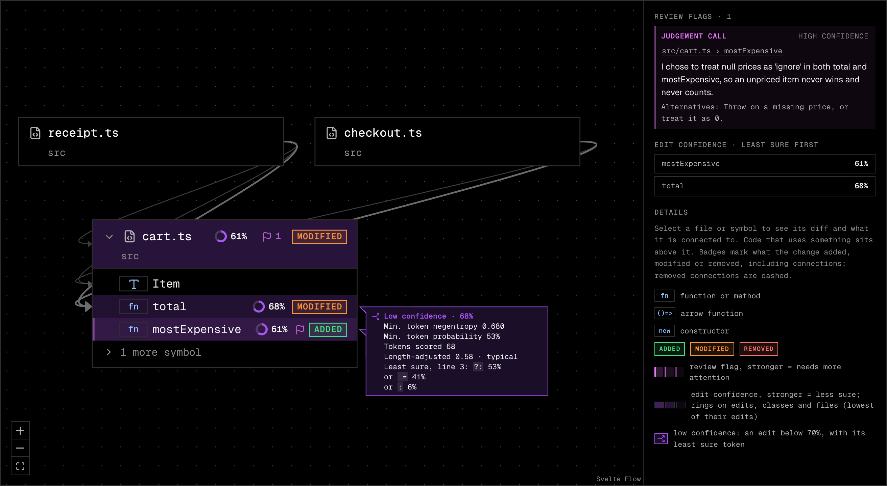

Rings without a bubble of their own open the same details on hover:

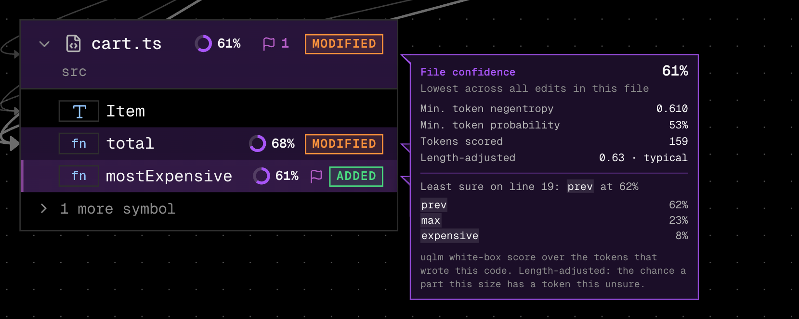

Select any row for its diff, what it uses and what uses it, and its confidence:

<p align="center">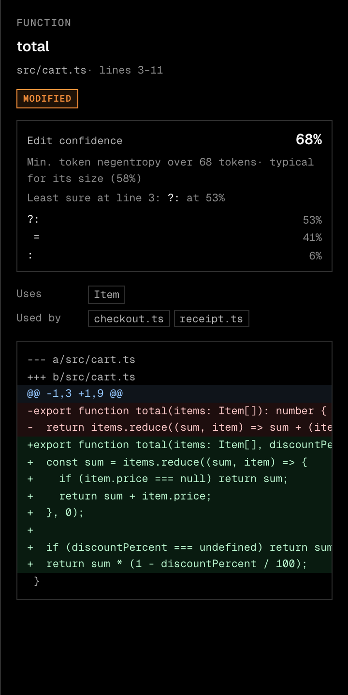</p>

### 5. The pull request

Pull requests come from a `tripsit/…` branch on top of the analyzed commit. The description contains your
instruction, the agent's summary and its review flags. When the app has a public HTTPS address, the pull request also
gets a picture of the change graph that follows the reader's GitHub theme and links back to the interactive graph:

<picture>
  <source media="(prefers-color-scheme: dark)" srcset="docs/images/pr-graph-dark.svg">
  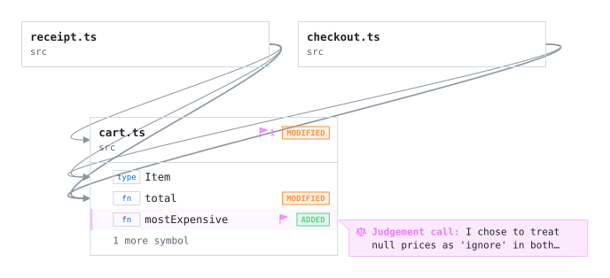
</picture>

### 6. Approve and merge, or reject

When you have reviewed the change, decide in the run view:

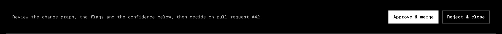

Both ask for confirmation first:

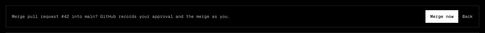

- **Approve & merge** submits an approving review and merges exactly the commit you reviewed. If the branch moved
  since, GitHub refuses and you are asked to reload. It uses squash, else a merge commit, else rebase, whichever the
  repository allows. Branch protection still applies, and GitHub's reason is shown if it refuses.
- **Reject & close** closes the pull request.
- Either way the `tripsit/…` branch is deleted, and the decision is saved with the run. Both act as you, and you need
  write access to the repository.

---

## Gemma 4 on Modal

The model runs in [`modal_gemma.py`](modal_gemma.py): one Modal class starts vLLM inside its container, and a small
FastAPI app in front of it adds what the agent and the confidence scoring need.

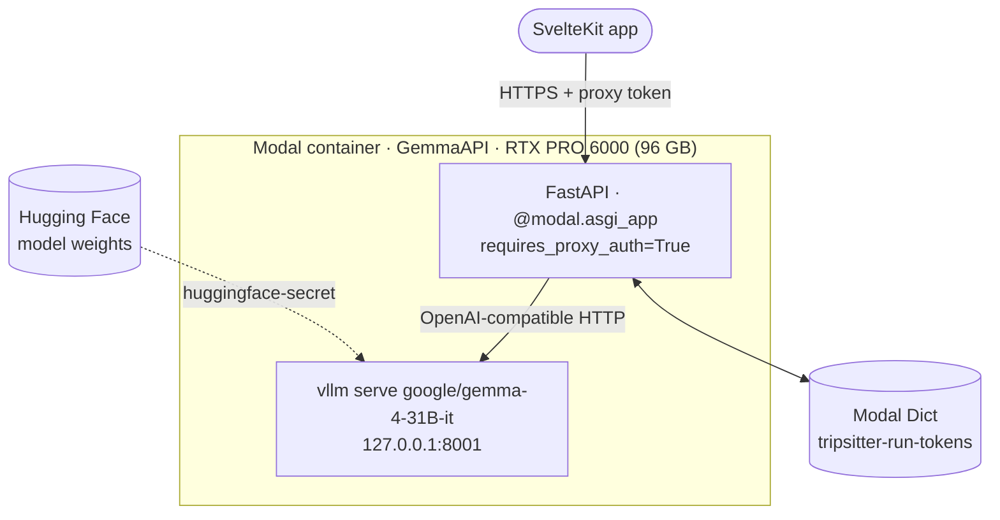

**The image.** It starts from Google's Gemma 4 vLLM image, `vllm/vllm-openai:gemma4`, adds Python 3.12, FastAPI and
httpx, and clears the image's `vllm` entrypoint so Modal can run its own function process. `model_output.py`,
`model_request.py` and `token_capture.py` are added as local Python sources.

**Starting vLLM.** In `@modal.enter()` the container runs `vllm serve` as a subprocess and waits up to 14 minutes for
its `/health` endpoint. `@modal.exit()` stops it. The flags that matter:

| vLLM flag | Why |
| --- | --- |
| `--max-model-len 65536` | Agent sessions need a long context. pi asks for at most 8,192 output tokens per turn. |
| `--gpu-memory-utilization 0.95` | The 31B model and its KV cache fit on one 96 GB GPU (`--tensor-parallel-size 1`). |
| `--logprobs-mode raw_logprobs` | Logprobs come from the model's raw output, before temperature or top-k/top-p, so confidence does not depend on sampling settings. |
| `--enable-auto-tool-choice --tool-call-parser gemma4` | Gemma 4's native tool calls become OpenAI `tool_calls` for the agent. |
| `--reasoning-parser gemma4` | Separates any reasoning from the answer. |
| `--chat-template …/tool_chat_template_gemma4.jinja` | vLLM's Gemma 4 tool-calling template, when the image ships it. |

**Container settings.** `gpu="RTX-PRO-6000"`, `min_containers=1` (one container stays warm), `scaledown_window=300`,
and a 900-second timeout and startup timeout. The Hugging Face token for the gated weights comes from the Modal secret
`huggingface-secret`.

**Routes.** The web endpoint uses Modal proxy auth; the app sends `MODAL_PROXY_TOKEN` with every request.

| Route | Purpose |
| --- | --- |
| `GET /health`, `GET /v1/models` | Health and the model id. |
| `POST /v1/chat/completions` | OpenAI-compatible chat. Streamed requests are relayed unchanged. Non-streamed ones also return `token_probabilities` for every generated token. |
| `POST /runs/{run_id}/v1/chat/completions` | Agent requests of one run. Generated non-streamed with the top 15 logprobs and replayed as a stream when the client asked for one. The tokens behind each `edit` and `write` call are kept. |
| `GET /runs/{run_id}/tokens` | A run's token records. |
| `DELETE /runs/{run_id}/tokens` | Forget a run's token records. The app calls it after collecting them. |

Disconnecting clients cancel generation upstream, and requests are bounded at 15 minutes.

**Deploying.** Every push to `main` deploys through `.github/workflows/modal-deploy.yml`. To deploy by hand:

```bash
pip install modal && modal token new          # once, to sign the CLI in
modal secret create huggingface-secret HF_TOKEN=hf_…   # once; accept the Gemma licence on Hugging Face first
modal deploy modal_gemma.py                   # from the repository root
```

`modal deploy` prints the endpoint URL (`https://…-gemmaapi-web.modal.run`): that is `MODAL_API_URL`. Create a proxy
auth token in the Modal workspace settings for `MODAL_PROXY_TOKEN`. A quick test:

```bash
curl "$MODAL_API_URL/v1/chat/completions" \
  -H "Authorization: Bearer $MODAL_PROXY_TOKEN" -H "Content-Type: application/json" \
  -d '{"model":"google/gemma-4-31B-it","max_tokens":8,"messages":[{"role":"user","content":"Reply with OK."}]}'
```

> **Note.** A deploy from an older `main` reverts these settings. Against a deployment without the `/runs` routes,
> agent runs still work, through `/v1`, and report edit confidence as unavailable.

## Getting token probabilities out of Gemma

To score an edit we need the probability of every token that wrote it and the alternatives the model weighed. Three
things make that possible.

**1. Generate non-streamed, with the top 15 logprobs.** pi streams its requests, but vLLM's streaming path can skip
chunks the tool-call parser holds back, and with them their logprobs. So for agent runs the relay asks vLLM for the
whole completion at once with `logprobs: true, top_logprobs: 15`, then replays it to pi as a normal OpenAI stream:
role and content, tool calls, finish reason, usage, `[DONE]`.

**2. Find the edit text in the raw tool call.** vLLM's logprobs cover the raw generated text, tool-call syntax
included. A Gemma 4 edit call looks like this, with string values unescaped between single `<|"|>` tokens:

```text
<|tool_call>call:edit{edits:[{newText:<|"|>def total(items, discount=0):
    amount = sum(item.price for item in items if item.price is not None)
    return amount * (1 - discount / 100)<|"|>,oldText:<|"|>def total(items): …<|"|>}],path:<|"|>cart.py<|"|>}<tool_call|>
```

[`token_capture.py`](token_capture.py) rebuilds the raw text from the token bytes and parses each `call:…{…}` block
into the character span of every string value and its path, such as `edits.0.newText`. It keeps a value only if its
tokens reproduce vLLM's parsed `tool_calls` argument exactly. Then the value's tokens are exactly the tokens between
its delimiters.

**3. Keep a compact record.** For the `newText` of each `edit` and the `content` of each `write`, every token becomes
`[start, end, logprob, negentropy, text, alternatives]`. `start` and `end` are UTF-16 offsets into the value, which is
what JavaScript strings use. Alternatives (the top three) are kept only for uncertain tokens. Records are appended to
the `tripsitter-run-tokens` Modal Dict under the run id, capped at 40,000 tokens per run. A mapping problem only drops
the record: the agent's request never fails because of capture.

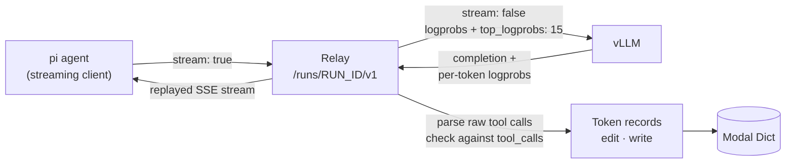

## Edit confidence: scoring every file and function

### Why `min_token_negentropy`

[uqlm](https://github.com/cvs-health/uqlm) offers several white-box scorers. Scorers that need several generations
(semantic entropy, Monte Carlo probability, functional entropy) would mean re-running the whole agent several times
and lining the runs up per function. Our earlier sampling prototype also found Gemma's samples identical on small
edits. Single-generation scorers work on any slice of tokens, so passing the tokens that wrote one function scores that
function at no extra cost.

Among those, averages (`sequence_probability`, `mean_token_negentropy`, `probability_margin`) are swamped by
near-certain syntax tokens: in our runs almost every token of an edit was above 99%. A **minimum** keeps the one place
where the model actually hesitated. Negentropy measures the spread of the whole top-15 distribution, so it does not
depend on which token sampling happened to pick.

For each generated token $t$, with its top $k = 15$ probabilities renormalized to $\hat p_{t,1}, \dots, \hat p_{t,k}$:

$$
\mathrm{negentropy}_t \;=\; 1 - \frac{H(\hat p_t)}{\ln k},
\qquad
H(\hat p_t) \;=\; -\sum_{i=1}^{k} \hat p_{t,i} \ln \hat p_{t,i}
$$

A token the model was sure of has a negentropy near 1; a token picked from a flat distribution is near 0. Our
implementation matches uqlm 0.6.8's `TopLogprobsScorer` to within $3 \times 10^{-16}$. When top-k data is missing, the
score falls back to the token probability (`min_probability`).

### From tokens to edits

The agent's edit and write tools run one at a time and record each file before and after every call, with the call's
id ([`pi-agent.ts`](frontend/src/lib/server/pi-agent.ts)). After the run
[`edit-confidence.ts`](frontend/src/lib/server/edit-confidence.ts) matches those calls to the captured tokens by tool-call
id and works out which token wrote every character of the final files:

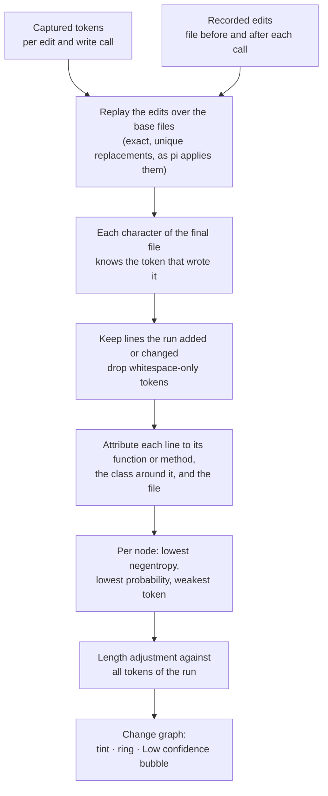

- **Replay.** Each recorded edit is applied again: its replacements are located in the file as it was before the call
  (exact and unique, as pi requires) and must reproduce the recorded result. Text from other tools, such as `bash`, has
  no token and is not scored.
- **Changed lines only.** Lines identical to the base file do not count, even when the model typed them again as
  context in a replacement. Whitespace-only tokens are formatting, not decisions, and are skipped.
- **Attribution.** A token counts for every symbol around its line (a method and its class) and for its file. The
  `(module)` bucket only takes top-level code outside any function or class.

### The score of a function, a class and a file

For node $v$ with scored tokens $T_v$, $n = |T_v|$:

$$
c(v) \;=\; \min_{t \in T_v} \mathrm{negentropy}_t
$$

Files and classes contain the edits inside them, so their score is the lowest of those edits.

A minimum gets lower as a function gets longer: a long function has more chances to contain one shaky token. To
compensate, we ask how unusual the minimum is for a node of that size. Let $F$ be the share of all scored tokens of the
run at or below $c(v)$. If the node's tokens were $n$ draws from the run, the chance of a minimum at least this low is

$$
a(v) \;=\; 1 - \bigl(1 - F(c(v))\bigr)^{n}
$$

Below $0.1$ the node is marked unusual for its size. It treats tokens as independent draws from the run, so it ranks
nodes within a run and is not calibrated across runs. It needs at least 20 scored tokens in the run.

### Worked example

From a real Gemma run asked to *"give total an optional discount percentage, ignore items without a price, and add a
function that returns the most expensive item"*:

| Node | Confidence | Least sure token | What the model weighed |
| --- | --- | --- | --- |
| `total` | 68% | `?:` in `discountPercent?: number` (53%) | ` =` 41%, a default value instead of an optional parameter |
| `mostExpensive` | 61% | `prev` in `reduce((prev, current) => …)` (62%) | `max` 23%, `expensive` 8% |
| `src/cart.ts` | 61% | the lowest of its edits | |

`total`'s weak spot is a real API decision. `mostExpensive`'s is a naming choice. Both fall below the 70% threshold,
so each gets a **Low confidence** bubble.

### On screen

| Element | Rule |
| --- | --- |
| Tint | Opacity $0.5\,(1 - c)^{0.8}$ in violet: nearly invisible at 95%, strong at 40%. |
| Ring | Every scored function, class and file, with its percentage. Brighter below 70%. |
| **Low confidence** bubble | Below 70%. One per least-sure token, on the most specific row, like review flags. |
| Comment / details | Confidence, Min. token negentropy, min. token probability, tokens scored, length-adjusted score, least sure token and alternatives. |

### Limits

Token probabilities cannot see decisions the model made confidently. An assumption baked in with certainty scores
high. That is why confidence complements the agent's review flags rather than replacing them. Code written through
`bash` is not scored. Design notes: [`specs/EDIT_CONFIDENCE_PLAN.md`](specs/EDIT_CONFIDENCE_PLAN.md) and
[`specs/tech-architecture/UNCERTAINTY_LATEST.md`](specs/tech-architecture/UNCERTAINTY_LATEST.md).

---

## Setup

### Requirements

- Node 22 and npm
- Python 3.12 (Modal service and its tests)
- A PostgreSQL database (Aiven, or local for development)
- A GitHub App (sign-in, repository access, pull requests)
- A Modal account with the Gemma endpoint deployed ([Gemma 4 on Modal](#gemma-4-on-modal))

### 1. Create the GitHub App

In GitHub, open **Settings → Developer settings → GitHub Apps → New GitHub App**:

| Setting | Value |
| --- | --- |
| Callback URL | `http://localhost:5173/api/auth/callback/github` (add the production URL later) |
| Setup URL | `http://localhost:5173/api/github/app/callback` (where GitHub returns after installation) |
| Repository permissions | Contents: Read and write · Pull requests: Read and write · Issues: Read-only · Metadata: Read-only |

Then note the **App ID**, **slug**, **Client ID**, generate a **client secret** and a **private key**.

### 2. Configure the web app

```bash
cd frontend
cp .env.example .env
npx auth@latest secret        # paste the value into BETTER_AUTH_SECRET
```

| Variable | Value |
| --- | --- |
| `MODAL_API_URL`, `MODAL_PROXY_TOKEN` | The deployed Modal endpoint and its proxy token |
| `MODEL_ID` | `google/gemma-4-31B-it` |
| `DATABASE_URL` | PostgreSQL connection URL |
| `BETTER_AUTH_SECRET` | A long random secret |
| `BETTER_AUTH_URL` | `http://localhost:5173` locally; the public HTTPS URL in production |
| `ORIGIN` | Production only: the same URL as `BETTER_AUTH_URL` |
| `GITHUB_APP_CLIENT_ID`, `GITHUB_APP_CLIENT_SECRET` | GitHub sign-in (the legacy `GITHUB_CLIENT_*` pair is not used for login) |
| `GITHUB_APP_ID`, `GITHUB_APP_PRIVATE_KEY` | Repository access. The PEM key may be multi-line, or one line with `\n` escapes. |
| `GITHUB_APP_SLUG` | Used for the **Install the Tripsit agent** link |

The remaining variables in `.env.example` (`REVIEWER_*`, `RUNNER_*`, `TRUSTED_CHECKS_JSON`,
`REQUIRED_CHECK_MANIFEST_JSON`) belong to the [earlier development slices](#earlier-development-slices) and are
optional.

### 3. Create the tables and start

```bash
npm install
npm run auth:migrate        # Better Auth tables
npm run projects:migrate    # the app's tables (agent runs, payloads); safe to re-run
npm run dev
```

Open <http://localhost:5173>, continue with GitHub, install the agent on a repository and run it.

## Deployment

### Web app on Aiven Runtime

The root `Dockerfile` builds a standalone SvelteKit Node server from `frontend/`. It sits at the repository root so
Aiven Runtime can find it, listens on port `8080`, and does not copy `.env` files. The production image adds `git`,
`bash` and `ripgrep` for the agent. Try it locally first:

```bash
docker build --tag tripsitter-web .
docker run --rm --env-file frontend/.env --publish 8080:8080 tripsitter-web
```

Then in Aiven:

1. Push the repository to GitHub.
2. In the Aiven project, open **Runtime → Deploy application**, connect GitHub and select this repository's `main`
   branch.
3. Select the root `Dockerfile` and expose port `8080` as the public HTTP port.
4. Set the variables and secrets below, connect a PostgreSQL service under **Connected services** so its connection
   string is exposed as `DATABASE_URL`, and deploy.

| Key | Aiven type | Value |
| --- | --- | --- |
| `BETTER_AUTH_URL` | Variable | The exact public HTTPS app URL, without a trailing slash |
| `ORIGIN` | Variable | The same URL |
| `MODAL_API_URL` | Variable | The deployed Modal endpoint |
| `MODEL_ID` | Variable | `google/gemma-4-31B-it` |
| `DATABASE_URL` | Connected-service value | Injected by the Aiven PostgreSQL integration |
| `BETTER_AUTH_SECRET` | Secret | A long random secret |
| `MODAL_PROXY_TOKEN` | Secret | The Modal proxy token |
| `GITHUB_APP_CLIENT_ID` | Variable | GitHub App client ID |
| `GITHUB_APP_CLIENT_SECRET` | Secret | GitHub App client secret |
| `GITHUB_APP_ID`, `GITHUB_APP_SLUG` | Variable | GitHub App id and slug |
| `GITHUB_APP_PRIVATE_KEY` | Secret | GitHub App private key |

Do not commit the database URL. For URLs with `sslmode=require` the app enables `uselibpqcompat=true` for Node's `pg`
automatically.

**First deployment checklist**, once the public URL is known:

1. Set `BETTER_AUTH_URL` and `ORIGIN` to it.
2. Add `https://YOUR-AIVEN-DOMAIN/api/auth/callback/github` as a callback URL and
   `https://YOUR-AIVEN-DOMAIN/api/github/app/callback` as the setup URL of the GitHub App.
3. Run `npm run auth:migrate` and `npm run projects:migrate` once against the production database, from a machine
   that can reach it with the production values set.
4. Redeploy. Aiven Runtime builds the selected commit, but pushes do not redeploy by themselves: use **Redeploy**, or
   add a CI step with an Aiven API token.

With a public HTTPS `BETTER_AUTH_URL`, each pull request also gets the graph picture. Its URL carries a key signed with
`BETTER_AUTH_SECRET`, so GitHub can load it without signing in. Anyone with that link sees file and symbol names, but
no source code.

### Modal

See [Gemma 4 on Modal](#gemma-4-on-modal). For CI deploys, add `MODAL_TOKEN_ID` and `MODAL_TOKEN_SECRET` as repository
secrets; `.github/workflows/modal-deploy.yml` then deploys on every push to `main`.

## Development

| Action | Command |
| --- | --- |
| Run the app | `cd frontend && npm run dev` |
| Type check | `cd frontend && npm run check` |
| Build | `cd frontend && npm run build` |
| Frontend tests (offline, as CI runs them) | ``cd frontend && node --experimental-strip-types --test $(find tests -maxdepth 1 -name '*.test.ts' ! -name '*-db.test.ts' ! -name 'intake-retention.test.ts' \| sort)`` |
| Modal service tests | `python3 -m unittest discover -s tests` |
| Admission-gate tests | `python3 -m unittest discover -s specs/experiments/tests` |

Pull requests run the same checks in `.github/workflows/ci.yml`.

```text
frontend/                    SvelteKit app: UI, API routes and the agent runtime
  src/routes/                the workspace page and /api routes
  src/lib/server/            pi agent, GitHub client, change graph, flags, edit confidence, run storage
  src/lib/components/        graph cards, bubbles, the sign-in wave
  tests/                     node:test suites
modal_gemma.py               Modal app: vLLM + FastAPI relay
token_capture.py             tool-call token mapping, negentropy, stream replay
model_request.py, model_output.py   relay helpers
specs/                       plans, designs and investigations
docs/images/                 screenshots for this README
```

## Security notes

- The agent gets a shell in a temporary copy of the repository. Its environment carries no server secrets, but it can
  run repository code with the server's network and file access. **Only run it on repositories you trust.**
- Runs are limited to one active run per user, two per server and six per user per hour, with a 20-minute deadline.
  Run payloads expire after seven days.
- Pull requests are opened with a GitHub App installation token, and only for users who can push. Merging and closing
  act as the signed-in user, after checking their write access.
- Edit token records live in the Modal Dict only until the app collects them. The app deletes them after every run,
  including failed ones.

---

## Earlier development slices

<details>
<summary>Issue intake, candidate generation and verification tooling (the UI for these was replaced by the workspace)</summary>

The app became a single workspace for agent runs. The earlier issue-intake and code-review screens were removed, but
their APIs, scripts and specs remain for the ongoing work in `specs/`.

### GitHub issue intake

Issue intake requires `GITHUB_APP_ID` and a PEM `GITHUB_APP_PRIVATE_KEY`, server-side only, for a GitHub App installed
on the selected repository with Contents and Issues read access. The signed-in user's token must independently access
the repository; the installation does not grant that user access. Snapshots store the supplied issue text and an
immutable base SHA, expire after seven days, and can be purged.

For an explicitly disposable **local** PostgreSQL database named `tripsit_e01s01_test`, set
`TRIPSIT_TEST_DATABASE_URL` and run from `frontend/`:

```bash
node --experimental-strip-types scripts/work-items.ts migrate
node --experimental-strip-types --test tests/e01s01.test.ts
node --experimental-strip-types --test tests/e01s01-db.test.ts
node --experimental-strip-types scripts/work-items.ts purge
npm run check && npm run build
```

The development script refuses non-local or differently named databases and never falls back to `DATABASE_URL`.
Applying a production migration or configuring a production purge schedule requires explicit authorization.

**Incomplete live gates:** private snapshot creation and reads remain refused. Real GitHub integration, authenticated
browser UAT and a periodic purge have not been certified.

- `python3 specs/experiments/live_gates.py e01s01 --require-configured` runs configured local API checks. It needs
  `TRIPSIT_LIVE_ORIGIN`, two owners' Cookie headers in `TRIPSIT_LIVE_OWNER_COOKIE` and `TRIPSIT_LIVE_OTHER_COOKIE`, and
  the fixture values `TRIPSIT_LIVE_REPOSITORY`, `TRIPSIT_LIVE_ISSUE_NUMBER`, `TRIPSIT_LIVE_REPOSITORY_ID`,
  `TRIPSIT_LIVE_BASE_SHA` and `TRIPSIT_LIVE_REVOKED_ITEM_ID`.
- From `frontend/`, `node scripts/intake-browser.mjs` checks the signed-in UI in installed Google Chrome with the same
  variables (`--browser-smoke` checks Chrome only). It signs the first owner out; use disposable development sessions.
- From `frontend/`, with the disposable local database configured,
  `node --experimental-strip-types scripts/intake-retention.ts` runs two timed purge subprocesses against an isolated
  schema.

Do not paste session cookies or credentials into reports or commit environment files.

### Candidate generation and assessment

The earlier flow had Gemma implement a captured issue as an isolated candidate, with an independently prompted
assessment (`REVIEWER_API_URL`, `REVIEWER_API_KEY`, `REVIEWER_MODEL`, optional `REVIEWER_RETENTION_DISCLOSURE`) and an
impact graph. Migration `002_candidates.sql` stores candidates. From `frontend/`, check the configured proxy with a
synthetic public fixture, and the graphical presentation with mocked APIs:

```bash
node --experimental-strip-types scripts/agent-probe.ts
node --experimental-strip-types scripts/workspace-presentation.mjs
```

The probe uses in-memory repository tools and storage and writes neither GitHub nor the database. It does not execute
generated code or prove correctness.

</details>
